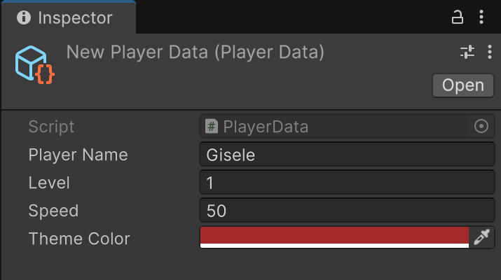
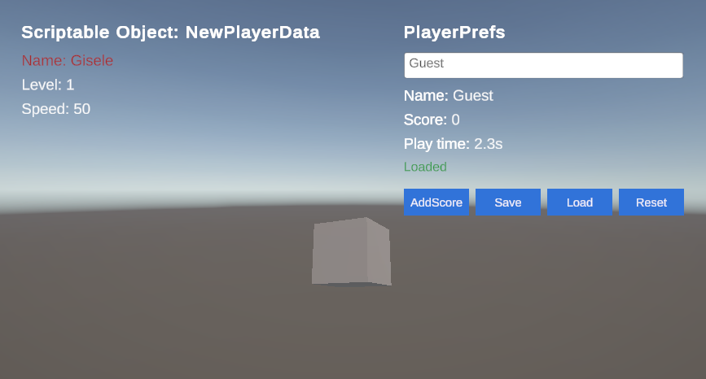
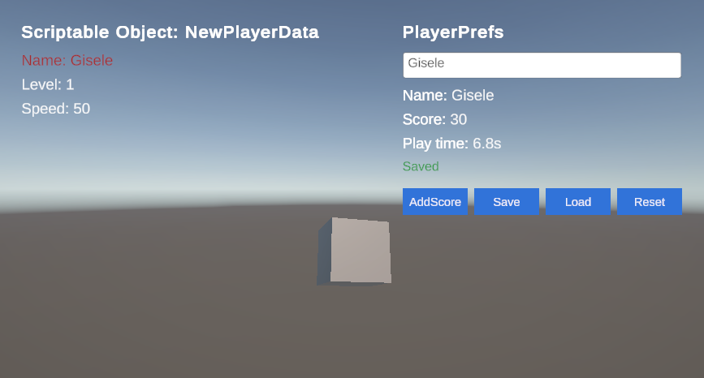
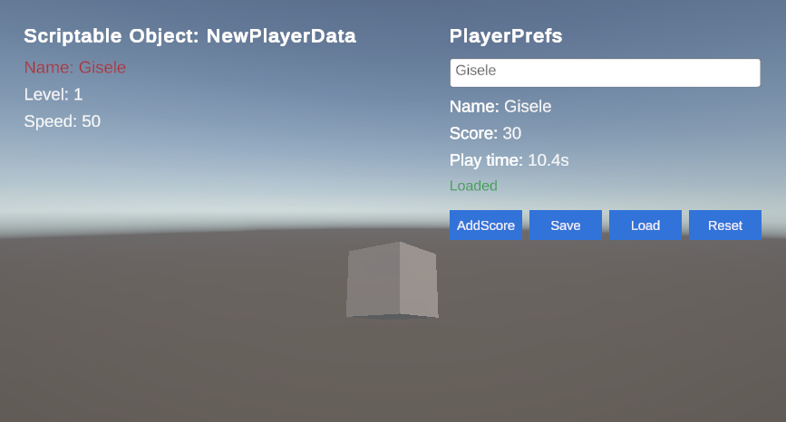
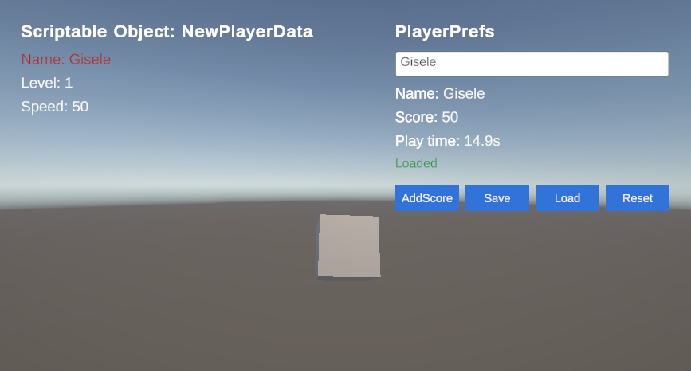
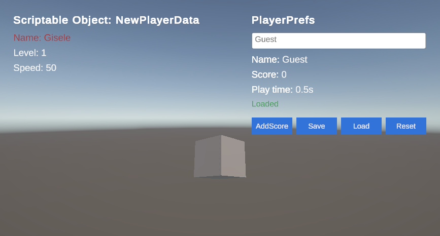
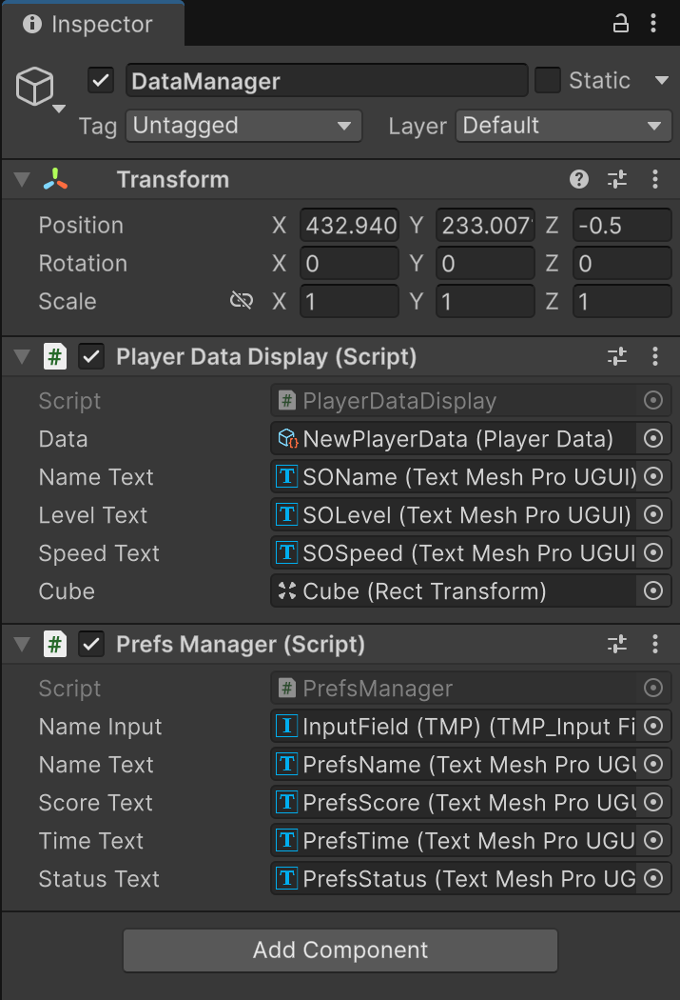
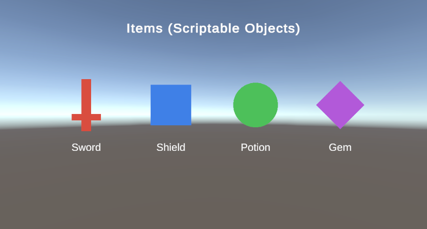
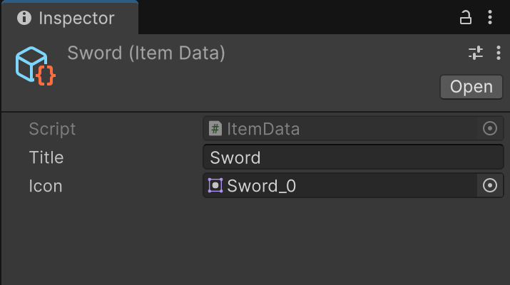

# Data Storage and Retrieval (Unity)

Class activity on **Scriptable Objects** and **PlayerPrefs**. Unity 6 (6000.6.7f1), URP.

## Scripts (`Assets/Scripts`)

| Script | What it does |
|---|---|
| `PlayerData.cs` | `ScriptableObject` with a `string` (playerName), `int` (level), `float` (speed) and `Color` (themeColor). Create via **Assets > Create > Game > Player Data**. |
| `PlayerDataDisplay.cs` | Control script. Reads the `NewPlayerData` asset and shows each value in the UI by type: the string as the name (tinted with the color), the int as the level, the float as the speed, which also spins the cube every frame. |
| `PrefsManager.cs` | Stores and retrieves 3 data types with PlayerPrefs: `SetString/GetString` (name), `SetInt/GetInt` (score), `SetFloat/GetFloat` (play time). Play time counts up live. Buttons call `AddScore`, `SaveData`, `LoadData` and `ResetData` (`DeleteAll`). Data also saves on quit. |
| `ItemData.cs` | Bonus: `ScriptableObject` with a `title` (string) and `icon` (Sprite). |
| `ItemDisplay.cs` | Bonus: reads 4 `ItemData` assets and shows each title as UI text and each icon as a UI image. |

Assets: `Assets/ScriptableObjects/NewPlayerData.asset` and `Assets/ScriptableObjects/Items/` (Sword, Shield, Potion, Gem).

## How to test

1. Open the project in Unity 6000.6.7f1.
2. **Scriptable Object + PlayerPrefs:** open `Assets/Scenes/SampleScene` and press Play.
   - The left side shows the values from `NewPlayerData`. Change them in the Inspector to see the UI change on the next Play.
   - On the right, type a name, click **AddScore** a few times, then **Save**.
   - Stop and press Play again. The name, score and play time are loaded back from PlayerPrefs.
   - **Load** reloads the saved values. **Reset** clears all PlayerPrefs.
3. **Bonus:** open `Assets/Scenes/DataStorage` and press Play to see the 4 items with their titles and icons.

## Screenshots

| | |
|---|---|
| Scriptable Object asset |  |
| Start (defaults loaded) |  |
| Data saved |  |
| Loaded after restarting Play |  |
| Updating over time |  |
| Reset |  |
| Control script wiring |  |
| Bonus items |  |
| Bonus item asset |  |
